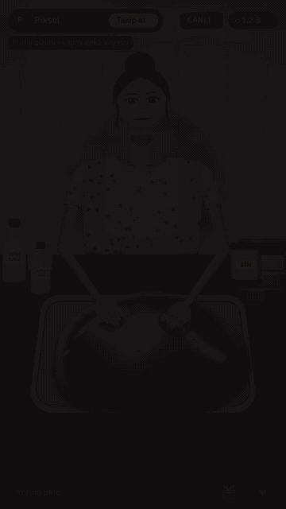
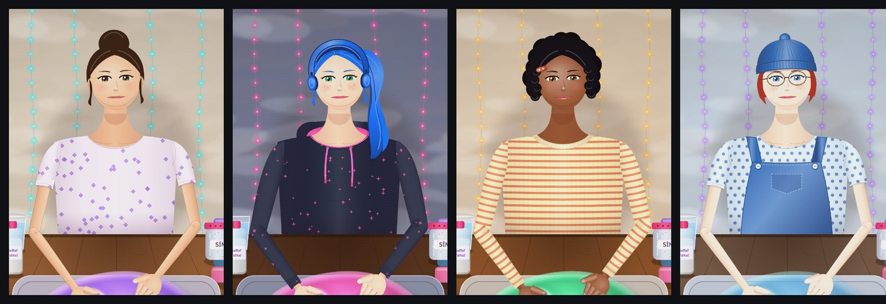
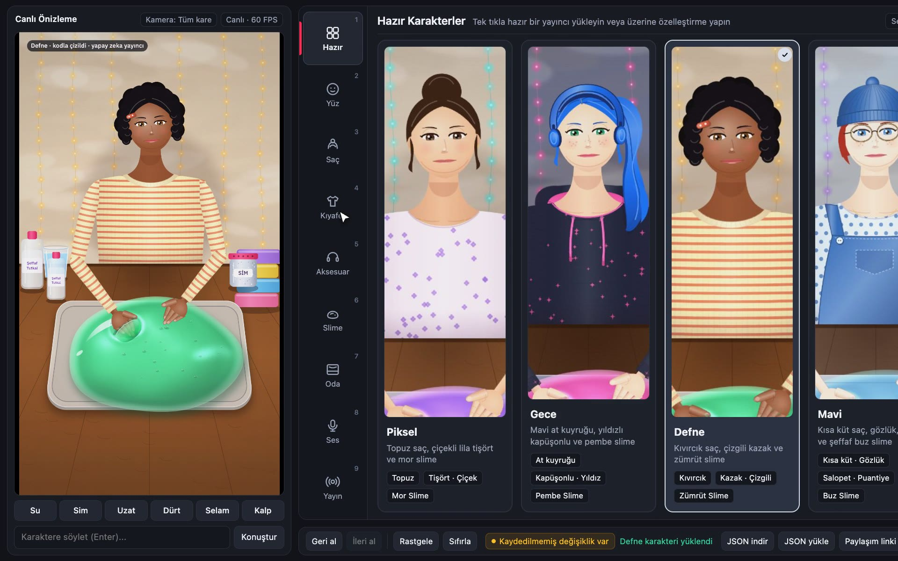

[Türkçe](README.md) · English

# Kodla Yayıncı (Coded Streamer)

A livestream character that kneads slime and replies to comments out loud, **with every frame drawn in code**. No image model, no video model: the character, slime, room, and hands are all Canvas code in a single HTML file. You can build your own character from the menu, make it speak with free voices, and optionally connect it to a TikTok livestream.







## Get started in 3 steps

**1. Give the repo to Claude Code.** Open Claude Code and type:

```
https://github.com/UgurKeskekci/kodla-tiktok-yayinci set this up
```

Claude clones the repo, checks dependencies, starts the server, and opens the menu in your browser.

**2. Build your character.** In the menu (http://127.0.0.1:5320/menu.html), pick the hair, skin, eyes, outfit, slime color, room, and voice. Type a sentence into the "Konuştur" (Speak) box to make the character say it. Action buttons: water, glitter, stretch, poke, wave, heart.

**3. Iterate with Claude.** Tell Claude Code what you want to change: "add a ribbon to her hair", "shape the slime into a heart", "draw a window in the background". If you specify three things (at which second, what is wrong, and what to keep), it gets it right on the first try.

## Manual setup

Requirements: [Node.js](https://nodejs.org) 20 or higher, Chrome or Edge.

```bash
git clone https://github.com/UgurKeskekci/kodla-tiktok-yayinci
cd kodla-tiktok-yayinci
npm install
npm start
```

- Menu: http://127.0.0.1:5320/menu.html
- Stage: http://127.0.0.1:5320/ (`?obs=1` for OBS)
- Control panel (test comments, gifts, TikTok connection): http://127.0.0.1:5320/panel.html
- Serverless demo: open `sahne.html?demo=1` directly in your browser.
- Livestream overlay view (comment feed, gift ticker, LIVE badge): `http://127.0.0.1:5320/?arayuz=canli`

The menu, the sample voices and the character's replies are in Turkish; the system itself works with any language you give it.

## Voices

| Engine | Cost | Setup | Notes |
|---|---|---|---|
| Browser voice | free | none | Quality depends on the browser; Turkish voice on Mac is good. |
| [Edge TTS](https://github.com/rany2/edge-tts) | free | `pip install edge-tts` | Emel (female), Ahmet (male); requires internet, 2-3s latency. |
| [VoxCPM2 Turkish voice design](https://github.com/alexturkey/voxcpm2-turkce-ses-tasarimi) | free, local | see that repo's setup | Design a voice from a text prompt; slow, better suited for preset lines than live chat. |
| [ElevenLabs](https://elevenlabs.io) | paid | `ELEVENLABS_API_KEY` | Most natural voice, ~0.7s latency. |

**Piksel's own voice is included in the repo:** `sesler/piksel/` was designed with VoxCPM2 from an English prompt (a friendly streamer in her twenties; the voice is synthetic and does not belong to a real person). If VoxCPM2 is installed, it appears in the Voice section of the menu as `piksel (bu repodan)`, runs locally, and is free. This is also the voice in the promo video. For the server to find VoxCPM2, set its path in `ayarlar.json` or via the `VOXCPM2_DIR` environment variable (see `ayarlar.ornek.json`). Lip sync is computed in real time from audio amplitude, or from syllable rhythm when using the browser voice.

Other free Turkish voices: [Ahenk](https://github.com/ozguradmin/ahenk-turkish-tts) (Özgür Güler; question intonation, emotion, laughter; weights are CC BY 4.0, credit Ahenk if you use it) and [EMA Lightning](https://huggingface.co/canberkkkkkk/ema-lightning) (Canberk Aslan, Apache 2.0, runs on CPU).

## Replying to comments (optional)

When a comment arrives, the character replies with a single sentence. It uses the first available provider in this order:

1. Claude Haiku if `ANTHROPIC_API_KEY` is set (fastest, ~1s)
2. The `claude` CLI if Claude Code is installed
3. The `agy` CLI (Gemini Flash) if Antigravity CLI is installed
4. If none are available, it does not generate replies; thank-you triggers and comment commands still work.

The character's persona and guardrails live in `kisilik.md`: she openly states that she is an AI drawn in code, does not ask for gifts, does not ask for personal information, and avoids politics and religion. Profane comments and links are skipped.

## TikTok livestream (optional)

While your livestream is live, enter your username in the panel and click "Bağlan" (Connect): comments, gifts, and follows are forwarded to the character. Viewers can trigger actions via chat commands: "uzat" (stretch), "dürt" (poke), "su" (water), "sim" (glitter), "selam" (wave). Gifts: 1 diamond triggers a heart, 5+ stretches, 10+ adds water, 100+ adds glitter. For OBS settings and guidelines, see [docs/yayin.md](docs/yayin.md).

- Turn on TikTok's AI-generated content label during streams; do not remove the on-stage "kodla çizildi · yapay zeka yayıncı" (drawn in code · AI streamer) label.
- Do not use fake comments or fake gifts on stream. The test buttons on the panel are only for offline testing.
- The TikTok connection relies on the unofficial [tiktok-live-connector](https://github.com/zerodytrash/TikTok-Live-Connector) library and may break if TikTok changes its protocol.

## How it was made

This character did not come out of a single prompt. For the step-by-step workflow, see [docs/is-akisi.md](docs/is-akisi.md).

## Files

| File | Description |
|---|---|
| `sahne.html` | Character, slime, room, animations, sound effects. Single file, zero dependencies. |
| `menu.html` | Customization menu. |
| `panel.html` | Testing and livestream control panel. |
| `sunucu.mjs` | Connects the stage, menu, voices, and TikTok. |
| `sesler.mjs` | Voice engines. |
| `beyin.mjs`, `kisilik.md` | Comment replies and character persona. |
| `assets/` | CC0 slime and water sound effects, preset character portraits. |
| `sesler/piksel/` | Piksel's VoxCPM2 voice (synthetic, designed from a text prompt). |
| `araclar/` | `denetim.mjs`: plays every animation and catches sudden frame jumps. `portreler.mjs`: generates preset character portraits. |

## Credits and licenses

- The stage originates from a film built with [Sarp Yıldız](https://x.com/sarpstar)'s **[cinecode](https://github.com/sarpstar/cinecode)** kit (MIT). If you want to make films with code, start there.
- Local Turkish voice: [VoxCPM2 Turkish voice design](https://github.com/alexturkey/voxcpm2-turkce-ses-tasarimi) (Apache 2.0). Piksel's voice was designed with it.
- Sound effects are CC0 from [Freesound](https://freesound.org): Eneasz (squishes), jtap97 (slime noise), Archos (slime 13), Breviceps (splat), swordofkings128 (pouring water), Jofae (chime), yfjesse (notification).
- Font: [IBM Plex](https://github.com/IBM/plex) (SIL Open Font License 1.1).
- [tiktok-live-connector](https://github.com/zerodytrash/TikTok-Live-Connector) (MIT).

Code is MIT licensed. See [LICENSE](LICENSE) and [NOTICE.md](NOTICE.md) for details.
